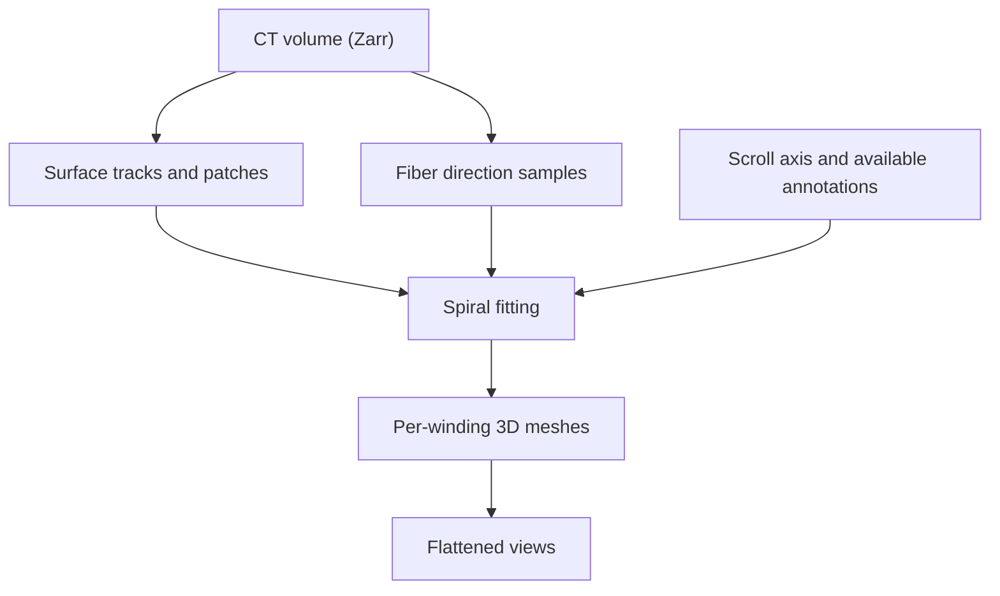

# Virtual Unwrapping of Herculaneum Scrolls

This project sets up a virtual unwrapping pipeline for the carbonized papyrus
scrolls from Herculaneum. It uses 3D CT scans to reconstruct the geometry of the
rolled sheet and map it onto a flat surface where traces of writing can be
examined.

The core method is **spiral fitting**. The fitter deforms a reference spiral
to match observations of the papyrus across the scan. A single model describes
the windings in the fitted region, including gaps between observed surface
fragments. Most of the code in this repository, including the spiral fitter,
comes from the Vesuvius Challenge's `ScrollPrize/villa` repository. This project
connects the fitter to tools that generate fitting inputs from CT scans.

## Pipeline

1. **Prepare the scan.** [Download a CT volume or crop](download_data/README.md)
   in Zarr format.
2. **Generate fitting inputs.** Use [surface predictions](surface_prediction/README.md)
   to [extract tracks and grow surface patches](spiral_fitting/README.md#generating-the-spiral-fit-input).
   [Fiber predictions](lasagna/README.md) provide additional evidence about
   the local orientation of the papyrus.
3. **Fit the spiral.** The [fitter](spiral_fitting/README.md#getting-started)
   uses the scroll's central axis as a reference and combines the generated
   inputs with available winding annotations. It produces a 3D mesh for each
   winding in the fitted region.
4. **Flatten and render.** [Flatten the fitted surface](spiral_fitting/villa_8aa507c/README.md#flattening-a-fitted-checkpoint)
   and [render views for ink inspection](spiral_fitting/README.md#getting-started-with-render_inkpy).

## Project structure

| Directory | Role and entry point |
| --- | --- |
| [`download_data/`](download_data/README.md) | Downloads CT volumes and published fitting datasets. Start with `download_zarr_from_url.py` for a CT volume or crop. The directory also contains Zarr/TIFF conversion utilities. |
| [`surface_prediction/`](surface_prediction/README.md) | Runs nnU-Net inference on Zarr volumes. `main.py` runs tiled inference, blends overlapping predictions, and writes surface probabilities or a binary mask to `final_output.zarr`. |
| [`lasagna/`](lasagna/README.md) | Predicts fiber presence and direction. `main.py` runs inference and `viewer.py` lets you inspect the predictions. |
| [`spiral_fitting/`](spiral_fitting/README.md) | Contains the input generation scripts and the `fit_spiral.py` entry point for the bundled fitter. Its guide also covers VC3D setup and ink rendering. |
| [`scrollreading/`](scrollreading/README.md) | Provides a separate, seed-based workflow for finding and flattening local surface patches. |
| [`surface_detection/`](surface_detection/README.md) | Contains the Kaggle-based surface segmentation workflow for TIFF stacks. |

The component guides document code sources and setup. Root-level
`data/`, `checkpoints/`, and `out/` are ignored by Git and can hold local
volumes, downloaded model weights, and run artifacts.

## Getting started

The [PHercParis4 fitting example](spiral_fitting/README.md#getting-started)
shows how to set up the environment, download published inputs, and fit a
selected slice range.

For a new scan region, align the generated inputs with the scroll axis and
any annotations in the same voxel coordinate system. Register the files in
[`spiral-scroll.json`](spiral_fitting/villa_8aa507c/README.md#scroll-specification-spiral-scrolljson)
and select the corresponding slice range in the fit configuration.

## Project status

This project is a work in progress.

## Sources

This project uses code from multiple sources. The component READMEs list the specific versions/commits and the locations of original code copies.

### Useful links

- [**Vesuvius Challenge**](https://scrollprize.org/) - project overview and background on the Herculaneum scrolls.
- [**Spiral fitting tutorial**](https://scrollprize.org/tutorial_spiral) - introduction to the fitting workflow.
- [**Virtual unwrapping with VC3D**](https://scrollprize.org/tutorial_VC3D) - guide to the VC3D workflow.
- [**VC3D segmentation tutorial (archived)**](https://scrollprize.org/segmentation) - earlier segmentation instructions.
